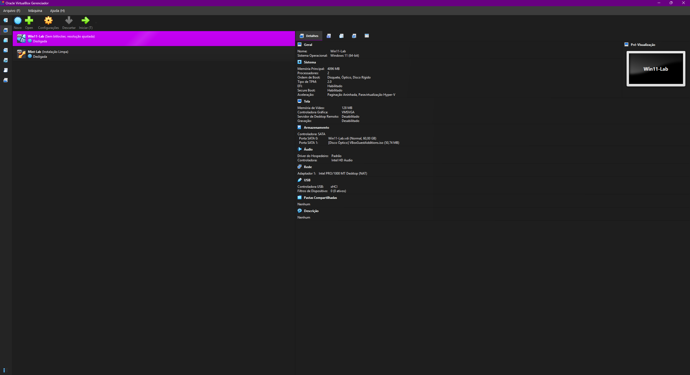
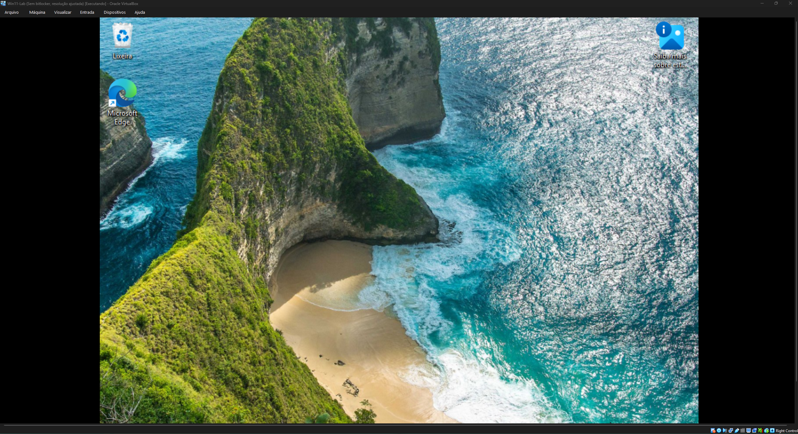
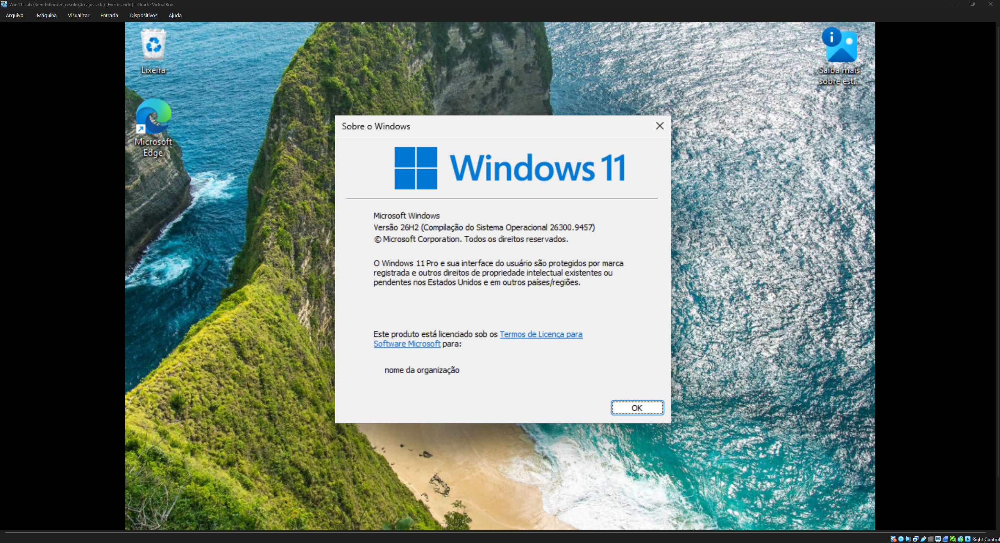
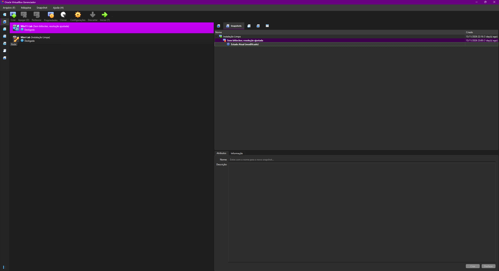
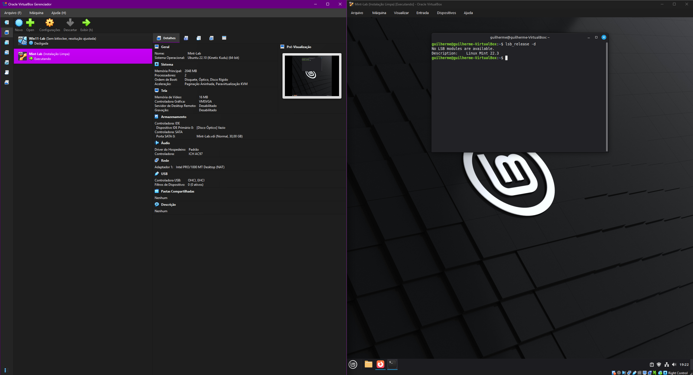
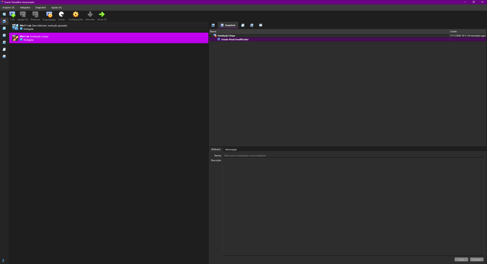

# Laboratório 1: máquinas virtuais com Windows 11 Pro e Linux Mint no VirtualBox

## Objetivo

Montar um ambiente de máquinas virtuais para praticar suporte técnico sem risco para o computador principal. Esse ambiente serve de base para os próximos laboratórios (acesso remoto, Active Directory, GLPI e redes).

## Ambiente

| Item | Detalhe |
| --- | --- |
| Hipervisor | Oracle VirtualBox 7.2.22 |
| Computador anfitrião | Windows 11, tela de 2560×1440 |
| VM 1 | Windows 11 Pro 26H2 (build 26300.9457), pt-BR |
| VM 2 | Linux Mint 22.3 |

### Configuração das VMs

| | Win11-Lab | Mint-Lab |
| --- | --- | --- |
| Memória | 4096 MB | 2048 MB |
| Processadores | 2 | 2 |
| Disco | 60 GB | 30 GB |
| Firmware | UEFI com Secure Boot e TPM 2.0 | BIOS (legado) |
| Controladora gráfica | VMSVGA, 128 MB | VMSVGA |
| Rede | NAT | NAT |

## Passo a passo

### Windows 11 Pro

1. Instalei o VirtualBox e baixei a ISO oficial do Windows 11 no site da Microsoft.
2. Criei a VM "Win11-Lab" com a opção de pular a instalação automática.
3. Em Sistema, ativei UEFI, Secure Boot e TPM 2.0, exigidos pelo Windows 11.
4. Iniciei a VM pela ISO e instalei a edição **Pro**, escolhida porque a edição Home não aceita acesso remoto por RDP, que uso no próximo laboratório.
5. Instalei as Adições para Convidado e criei o snapshot "Instalação Limpa".
6. Depois de resolver os problemas descritos abaixo (BitLocker e resolução da tela), criei o snapshot "Sem bitlocker, resolução ajustada".






### Linux Mint

1. Baixei a ISO do Linux Mint (Cinnamon) em linuxmint.com.
2. Criei a VM "Mint-Lab" com a mesma opção de pular a instalação automática.
3. Instalei o sistema, atualizei os pacotes com `sudo apt update && sudo apt upgrade -y` e instalei as adições com `sudo apt install virtualbox-guest-utils virtualbox-guest-x11`.
4. Criei o snapshot "Instalação Limpa".




## Problemas encontrados

### 1. Tela preta ao iniciar a VM do Windows 11

- **Sintoma:** a VM iniciava e a tela ficava totalmente preta, sem instalador.
- **Diagnóstico:** conferi se a ISO estava anexada na VM, verifiquei a ordem de boot e testei o menu de boot do UEFI. A ISO estava anexada corretamente, então o problema era de vídeo.
- **Causa:** a controladora gráfica VBoxSVGA não funcionou nessa combinação de UEFI, Secure Boot e TPM 2.0.
- **Solução:** com a VM desligada, troquei a controladora gráfica para **VMSVGA** em Configurações, Display.

### 2. Tela azul de recuperação do BitLocker

- **Sintoma:** depois de reiniciar a VM, o Windows pediu a chave de recuperação do BitLocker.
- **Causa:** o Windows detectou uma mudança na política de Inicialização Segura (Secure Boot). Como entrei com uma conta Microsoft, a criptografia de dispositivo foi ativada automaticamente.
- **Solução:** peguei a chave de recuperação pela conta Microsoft, no site aka.ms/myrecoverykey, procurando pelo ID exibido na tela, e digitei na VM. Depois desativei a criptografia de dispositivo em Configurações, Privacidade e segurança, porque em um laboratório ela não é necessária.

### 3. Resolução da tela travada em 1024×768

- **Sintoma:** a tela do Windows ficava pequena e quadrada, e a opção de resolução estava bloqueada.
- **Causa:** a controladora VMSVGA não é a recomendada para Windows e não permite o ajuste automático da resolução.
- **Solução:** defini a resolução do firmware UEFI pela linha de comando, com a VM desligada:
  ```
  VBoxManage setextradata "Win11-Lab" "VBoxInternal2/EfiGraphicsResolution" "1920x1080"
  ```

## O que aprendi

- O Windows 11 exige UEFI, TPM 2.0 e Secure Boot, e isso precisa estar configurado na VM antes da instalação.
- A criptografia de dispositivo do Windows ativa sozinha com conta Microsoft, e a chave de recuperação fica na conta.
- Tirar snapshots antes de mexer em configurações permite voltar atrás sem refazer a instalação.
- Diagnosticar por eliminação (ISO, ordem de boot, vídeo) é mais rápido do que refazer tudo.

## Próximos passos

- Laboratório 2: acesso remoto com RDP, AnyDesk e TeamViewer entre o computador e a VM.
- Trocar a rede das VMs para Bridge para as duas se enxergarem.
